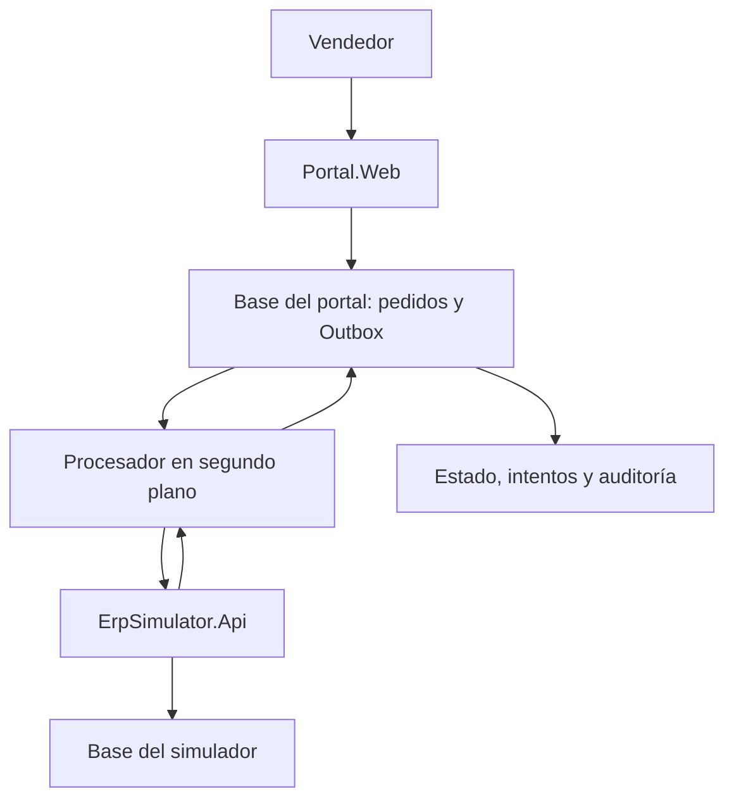

# PortalPedidos

**Portal comercial en .NET con integración asíncrona a un ERP simulado.**

PortalPedidos centraliza la gestión de pedidos, la consulta de clientes y productos, la administración de equipos comerciales y el seguimiento de integraciones.

El proyecto aborda un escenario habitual en sistemas empresariales: un vendedor registra un pedido y necesita conocer su resultado, incluso cuando el sistema externo tarda en responder o se interrumpe la comunicación.

Desarrollado con **ASP.NET Core MVC, C#, Entity Framework Core y SQL Server**, con una arquitectura por capas y un simulador ERP independiente.

> **Estado:** proyecto de portafolio en desarrollo y consolidación. Incluye los módulos descritos a continuación; la validación funcional integral y la suite automatizada están pendientes. La integración actual utiliza un ERP simulado, no SAP Business One.

## Contenido

- [Problema que resuelve](#problema-que-resuelve)
- [Funcionalidades](#funcionalidades)
- [Integración y decisiones técnicas](#integración-y-decisiones-técnicas)
- [Arquitectura](#arquitectura)
- [Tecnologías](#tecnologías)
- [Instalación local](#instalación-local)
- [Recorrido de demostración](#recorrido-de-demostración)
- [Diagnóstico](#diagnóstico)
- [Alcance y próximos pasos](#alcance-y-próximos-pasos)
- [Autor](#autor)

## Problema que resuelve

En una operación comercial, registrar pedidos implica más que guardar un formulario:

- Los clientes y productos deben corresponder al catálogo del ERP.
- Los precios y la disponibilidad pueden cambiar.
- Los usuarios requieren permisos distintos según sus responsabilidades.
- Una respuesta perdida no significa necesariamente que el ERP haya rechazado el pedido.
- Las incidencias necesitan trazabilidad para ser investigadas y recuperadas.

PortalPedidos separa la captura comercial del procesamiento de la integración y ofrece herramientas para consultar el estado del pedido y sus intentos de envío.

## Funcionalidades

| Módulo | Capacidades |
|---|---|
| Acceso y usuarios | Inicio y cierre de sesión, administración de usuarios, roles y políticas de autorización. |
| Panel | Resumen de la actividad y accesos a los módulos del portal. |
| Pedidos | Creación y edición de borradores, cancelación, envío y consulta de detalle e historial. |
| Recuperación comercial | Copia de pedidos rechazados a nuevos borradores. |
| Consulta de pedidos | Búsqueda, filtros, paginación, exportación CSV y vista de impresión. |
| Clientes | Directorio con búsqueda, filtros de estado e información de elegibilidad. |
| Cartera comercial | Asignación y retiro de responsables, consulta de asignación vigente e historial. |
| Equipos comerciales | Gestión de equipos y membresías. |
| Catálogo | Consulta de productos, precios y existencias sincronizados desde el simulador. |
| Integraciones | Procesamiento en segundo plano, monitor de intentos y recuperación autorizada. |
| Auditoría | Consulta de eventos, filtros y detalle para seguimiento de operaciones. |
| Asistente de búsqueda | Interpretación de consultas acotadas como «pedidos rechazados» o «clientes activos». |
| Interfaz | Vistas Razor con Bootstrap, modo claro y modo oscuro. |

El asistente de búsqueda utiliza reglas y expresiones regulares. No utiliza un modelo generativo ni ejecuta operaciones comerciales por iniciativa propia.

### Estados del pedido

| Estado técnico | Significado |
|---|---|
| `Draft` | Borrador pendiente de envío. |
| `Queued` | Pedido en cola de integración. |
| `Confirmed` | Pedido confirmado por el ERP. |
| `Rejected` | Pedido rechazado. |
| `Cancelled` | Borrador cancelado. |

Los intentos y las incidencias de integración tienen su propio seguimiento. Un fallo de comunicación requiere evaluar el resultado de la integración; no debe interpretarse automáticamente como un rechazo comercial.

### Elegibilidad y cartera

La regla actual de elegibilidad comprueba que el cliente exista y esté activo.

La asignación de responsable comercial se administra por separado:

- Cambiar el responsable no transfiere automáticamente la propiedad de un borrador.
- El cambio de responsable no bloquea por sí mismo un borrador.
- Los permisos y la visibilidad del pedido siguen sujetos a la autorización existente.
- La restricción de clientes por vendedor responsable no está activada en este bloque.

## Integración y decisiones técnicas

### Procesamiento mediante Outbox

El portal utiliza mensajes persistidos para desacoplar el envío al ERP de la solicitud web del usuario.



El procesamiento incorpora:

- **Idempotencia:** identificación estable de la operación para gestionar reintentos.
- **Integridad del mensaje:** comprobación del hash del contenido almacenado.
- **Control de procesamiento:** leases y controles transaccionales para coordinar el trabajo.
- **Consulta del resultado externo:** recuperación de información cuando el resultado del envío es incierto.
- **Trazabilidad:** registro de intentos y eventos relevantes.
- **Simulación de fallos:** soporte de desarrollo para interrumpir una respuesta después de la aceptación del pedido.

Estos mecanismos forman parte de la implementación. Su validación completa frente a fallos y concurrencia está contemplada en el cierre de pruebas.

### Otras decisiones

- Interfaces y DTOs separados de las implementaciones.
- Entity Framework Core con configuraciones y migraciones versionadas.
- Control de concurrencia mediante versiones en operaciones que lo requieren.
- Consultas de listado con filtros y paginación.
- Políticas de autorización centralizadas.
- Comunicación con el simulador mediante HTTPS y API key.
- Fechas presentadas según el contexto horario de Perú.
- Credenciales de desarrollo fuera del repositorio.

## Arquitectura

La solución está organizada en cinco proyectos:

| Proyecto | Responsabilidad |
|---|---|
| `Portal.Domain` | Entidades y enumeraciones del negocio. |
| `Portal.Application` | Contratos, interfaces, DTOs y excepciones de aplicación. |
| `Portal.Infrastructure` | Persistencia, Identity, consultas, servicios, sincronización e integración ERP. |
| `Portal.Web` | Presentación MVC, controladores, ViewModels, vistas y servicios en segundo plano. |
| `ErpSimulator.Api` | API independiente que simula catálogo, existencias y recepción de pedidos. |

### Ubicación de los proyectos

| Proyecto | Ruta |
|---|---|
| Dominio | `src/Portal.Domain/Portal.Domain/` |
| Aplicación | `src/Portal.Application/` |
| Infraestructura | `src/Portal.Infrastructure/` |
| Portal web | `src/Portal.Web/` |
| ERP simulado | `src/ErpSimulator.Api/` |

La solución principal es `PortalPedidos.slnx`.

El portal y el simulador utilizan bases de datos independientes, cada una con sus propias migraciones.

### Archivos de interés técnico

- [Procesador Outbox](src/Portal.Infrastructure/Integration/OrderOutboxProcessor.cs)
- [Servicio de borradores](src/Portal.Infrastructure/Services/Orders/OrderDraftService.cs)
- [Recuperación de integraciones](src/Portal.Infrastructure/Integrations/IntegrationRecoveryService.cs)
- [Sincronización del catálogo](src/Portal.Infrastructure/Synchronization/CatalogSyncService.cs)
- [Elegibilidad del cliente](src/Portal.Infrastructure/Services/Customers/CustomerEligibilityService.cs)
- [Visibilidad de pedidos](src/Portal.Infrastructure/Queries/Security/OrderVisibility.cs)
- [Asistente de búsqueda](src/Portal.Infrastructure/Services/Search/LocalSearchAssistant.cs)

## Tecnologías

| Área | Tecnología |
|---|---|
| Plataforma | .NET 10 y C# |
| Presentación | ASP.NET Core MVC y Razor |
| Interfaz | Bootstrap, CSS y JavaScript |
| Autenticación | ASP.NET Core Identity |
| Persistencia | Entity Framework Core |
| Base de datos | SQL Server |
| API del simulador | ASP.NET Core Minimal APIs |
| Comunicación | HTTP/HTTPS y JSON |
| Procesamiento | Servicios en segundo plano |
| Control de versiones | Git y GitHub |

## Instalación local

La siguiente guía está orientada a **Windows y PowerShell**. Ejecuta los comandos desde la raíz del repositorio, salvo que se indique lo contrario.

### 1. Requisitos

- SDK de .NET 10.
- Git.
- Una instancia de SQL Server disponible.
- Permisos para crear y actualizar las bases de desarrollo.
- Visual Studio compatible con .NET 10, opcional.
- Certificado HTTPS de desarrollo confiable.

El archivo `IniciarPortal.cmd` inicia las aplicaciones después de la preparación inicial. No instala SQL Server ni configura las credenciales.

### 2. Clonar y restaurar

```powershell
git clone https://github.com/fmarquezrojas-dev/PortalPedidos.git
cd PortalPedidos

dotnet restore PortalPedidos.slnx
dotnet dev-certs https --trust
```

Si el repositorio es privado, necesitarás acceso autorizado para clonarlo.

### 3. Configurar los secretos

Ambos proyectos ejecutables tienen configurado `UserSecretsId`.

En Visual Studio, utiliza **Administrar secretos de usuario** en cada proyecto e incorpora los valores correspondientes.

**Portal.Web:**

```json
{
  "ConnectionStrings": {
    "PortalDb": "Server=TU_SERVIDOR_SQL;Database=PortalPedidosDev;Integrated Security=True;Encrypt=True;TrustServerCertificate=True"
  },
  "Erp": {
    "BaseUrl": "https://localhost:7117/",
    "ApiKey": "SUSTITUIR_POR_UNA_CLAVE_ALEATORIA"
  }
}
```

**ErpSimulator.Api:**

```json
{
  "ConnectionStrings": {
    "ErpSimulatorDb": "Server=TU_SERVIDOR_SQL;Database=ErpSimulatorDev;Integrated Security=True;Encrypt=True;TrustServerCertificate=True"
  },
  "Simulator": {
    "ApiKey": "SUSTITUIR_POR_LA_MISMA_CLAVE_ALEATORIA"
  }
}
```

Estas conexiones son ejemplos para autenticación integrada de Windows. Sustituye el servidor y adapta la autenticación a tu instancia.

`TrustServerCertificate=True` se utiliza aquí únicamente para el entorno local de desarrollo.

Genera una clave aleatoria con PowerShell:

```powershell
$bytes = New-Object byte[] 32
$rng = [System.Security.Cryptography.RandomNumberGenerator]::Create()
$rng.GetBytes($bytes)
$rng.Dispose()
[Convert]::ToBase64String($bytes)
```

Copia el resultado en ambas claves:

- `Erp:ApiKey`
- `Simulator:ApiKey`

Deben coincidir exactamente. No utilices los textos de ejemplo como credenciales.

No publiques contraseñas, claves API ni archivos de secretos. User Secrets separa la configuración del repositorio; no sustituye un gestor de secretos de producción.

### 4. Preparar las bases de datos

Los proyectos utilizan Entity Framework Core `10.0.12`. Para instalar la herramienta CLI correspondiente, si todavía no la tienes:

```powershell
dotnet tool install --global dotnet-ef --version 10.0.12
```

Si ya existe una instalación, comprueba su versión con `dotnet ef --version` y utiliza una versión compatible con los paquetes del proyecto.

Selecciona el entorno de desarrollo:

```powershell
$env:ASPNETCORE_ENVIRONMENT = "Development"
```

Aplica las migraciones del portal:

```powershell
dotnet ef database update --project src/Portal.Infrastructure --startup-project src/Portal.Web --context PortalDbContext
```

Aplica las migraciones del simulador:

```powershell
dotnet ef database update --project src/ErpSimulator.Api --startup-project src/ErpSimulator.Api --context ErpSimulatorDbContext
```

Las migraciones existentes preparan el esquema. No es necesario generar una migración nueva para instalar el proyecto.

Utiliza bases dedicadas a esta demostración.

### 5. Preparar catálogo, roles y usuarios

Carga los datos iniciales del simulador:

```powershell
dotnet run --project src/ErpSimulator.Api --no-launch-profile -- --environment Development --seed-catalog
```

Prepara los roles y usuarios:

```powershell
dotnet run --project src/Portal.Web --no-launch-profile -- --environment Development --seed-roles --seed-users
```

Para cuentas nuevas, el comando solicita una contraseña y su confirmación.

| Cuenta de desarrollo | Rol |
|---|---|
| `vendedor@portal.test` | Vendedor |
| `operador@portal.test` | Operador |
| `admin@portal.test` | Administrador |

No existe una contraseña pública predeterminada. Las contraseñas se eligen durante la preparación local.

Los comandos de inicialización están restringidos al entorno `Development`.

### 6. Comprobar la integración y sincronizar

En una primera terminal, inicia el simulador:

```powershell
dotnet run --project src/ErpSimulator.Api --launch-profile https
```

Conserva esa terminal abierta.

En una segunda terminal, desde la raíz del repositorio, comprueba la conexión:

```powershell
dotnet run --project src/Portal.Web --no-launch-profile -- --environment Development --check-erp
```

Después sincroniza el catálogo:

```powershell
dotnet run --project src/Portal.Web --no-launch-profile -- --environment Development --sync-catalog
```

`--check-erp` consulta el catálogo sin guardarlo. `--sync-catalog` actualiza el catálogo del portal.

### 7. Iniciar el portal

Con el simulador todavía activo:

```powershell
dotnet run --project src/Portal.Web --launch-profile https
```

Abre:

**https://localhost:7271/Account/Login**

Para los siguientes arranques, detén las ejecuciones manuales con `Ctrl+C` y ejecuta:

```powershell
.\IniciarPortal.cmd
```

También puedes abrir ese archivo mediante doble clic.

El iniciador compila la solución, arranca ambos servicios y abre el navegador. Conserva abiertas sus ventanas mientras utilizas el portal.

### Direcciones locales

| Servicio | Dirección |
|---|---|
| Portal | `https://localhost:7271/` |
| Inicio de sesión | `https://localhost:7271/Account/Login` |
| ERP simulado | `https://localhost:7117/` |
| Catálogo del simulador | `https://localhost:7117/sim-api/v1/catalog` |

Las rutas comerciales del simulador requieren la cabecera `X-Api-Key`. Abrirlas directamente en el navegador sin esa cabecera puede producir un rechazo de autenticación.

La raíz del simulador no tiene una página de inicio; una respuesta 404 en `/` no implica que la API esté caída.

## Recorrido de demostración

1. Iniciar sesión con una cuenta de desarrollo.
2. Consultar el directorio de clientes y el catálogo sincronizado.
3. Crear un borrador con un cliente activo y productos disponibles.
4. Revisar cantidades, precios y fecha solicitada.
5. Guardar y consultar el detalle.
6. Enviar el pedido.
7. Consultar el resultado del procesamiento.
8. Revisar el historial y los intentos de integración con una cuenta autorizada.
9. Explorar cartera, equipos, usuarios y auditoría según los permisos.
10. Cambiar entre modo claro y oscuro.

Los menús y operaciones disponibles dependen de los permisos del usuario.

## Diagnóstico

### Disponibilidad de los servicios

| Endpoint | Qué comprueba |
|---|---|
| `/health` | Que el proceso atienda solicitudes. |
| `/health/ready` | La comprobación de disponibilidad de base de datos registrada por la aplicación. |

Ejemplos:

```powershell
Invoke-RestMethod https://localhost:7117/health
Invoke-RestMethod https://localhost:7271/health

Invoke-WebRequest https://localhost:7117/health/ready
Invoke-WebRequest https://localhost:7271/health/ready
```

La comprobación del proceso no garantiza por sí sola que SQL Server o la integración estén disponibles.

### Incidencias frecuentes

| Síntoma | Revisar |
|---|---|
| Conexión de base de datos ausente | Secretos del proyecto y entorno `Development`. |
| Error al conectar con SQL Server | Instancia, autenticación, disponibilidad y cadena de conexión. |
| Error de certificado HTTPS | Certificado de desarrollo y ejecución de `dotnet dev-certs https --trust`. |
| API key rechazada | Coincidencia entre `Erp:ApiKey` y `Simulator:ApiKey`. |
| Catálogo vacío | Carga inicial del simulador y sincronización del portal. |
| Puerto ocupado | Otra ejecución desde Visual Studio o una terminal. |
| Pedido permanece en cola | Worker Outbox, disponibilidad del simulador y monitor de integración. |
| Acceso denegado | Rol, permisos, estado del usuario y alcance de visibilidad. |

## Alcance y próximos pasos

### Alcance actual

- Implementación orientada a un entorno de desarrollo y demostración.
- ERP simulado con persistencia independiente.
- Integración asíncrona con seguimiento y recuperación.
- Administración comercial y de usuarios.
- Asistente de búsqueda basado en reglas.
- Interfaz con modo claro y oscuro.

### Pendientes de consolidación

- Pruebas funcionales integrales.
- Pruebas automatizadas de autorización, concurrencia e integración.
- Verificación de reintentos y respuestas perdidas.
- Automatización de compilación mediante GitHub Actions.
- Capturas y video de demostración.
- Medición de rendimiento con datos representativos.
- Documentación y preparación de un despliegue público.

### Evoluciones previstas

- Evaluar la integración real con SAP Business One.
- Ampliar las reglas comerciales de cartera cuando se defina su alcance.
- Evaluar capacidades de búsqueda adicionales según necesidades de uso.

Las evoluciones previstas no forman parte de las capacidades implementadas anunciadas en este README.

## Autor

**Fabrizio Antonio Marquez Rojas**

Desarrollador de software y estudiante de Ingeniería de Software, con interés en desarrollo backend con .NET, bases de datos e integraciones empresariales.

GitHub: [@fmarquezrojas-dev](https://github.com/fmarquezrojas-dev)

---

Proyecto de portafolio enfocado en gestión comercial, trazabilidad e integración entre sistemas.
